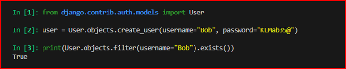

# Django Project: Core

## Description

This project includes multiple functionalities across three core applications:

### 1. Blog:
- **Features**:
  - Users can create, read, update, and delete blog posts.
  - Each blog post includes a title, description, image, and metadata such as the author’s name and publication date.
  - Comments can be added to blog posts by other users.
  - The blog module supports user authentication, ensuring that only the author can edit or delete their own posts.
  - Users can browse and explore blog posts using a visually appealing interface with Bootstrap styling.

---

### 2. Event Manager:
- **Features**:
  - Users can create and manage events with details such as title, date, location, and description.
  - Event creators can edit or delete their events.
  - The system supports user authentication, ensuring event security and integrity.
  - Events are displayed in an organized list, allowing attendees to view details and RSVP.
  
- **RSVP Button**:
  - When a user clicks the RSVP button, their name is added to the list of attendees visible on the event’s detail page.
  - This feature helps organizers track who plans to attend.

---

### 3. Recipe:
- **Features**:
  - Users can create, share, and explore recipes for different dishes.
  - Each recipe includes detailed information such as ingredients, preparation steps, cooking time, and images.
  - Recipe management supports full CRUD functionality for authenticated users.

---
### Recipe REST API

The Recipe application also provides a REST API built with Django REST Framework.

#### API Features:
- List and retrieve recipes
- Create recipes for authenticated users
- Update and delete recipes
- Automatically associate a new recipe with the authenticated user
- Read-only access for unauthenticated users
- Owner-based permissions: only the recipe owner can update or delete it

#### API Endpoints:

| Method | Endpoint | Description |
|--------|----------|-------------|
| GET | `/recipes/api/recipes/` | List all recipes |
| POST | `/recipes/api/recipes/` | Create a new recipe |
| GET | `/recipes/api/recipes/<id>/` | Retrieve a recipe |
| PUT | `/recipes/api/recipes/<id>/` | Update a recipe |
| PATCH | `/recipes/api/recipes/<id>/` | Partially update a recipe |
| DELETE | `/recipes/api/recipes/<id>/` | Delete a recipe |

The API uses Django REST Framework serializers, generic API views, authentication, and custom object-level permissions.

---
### Key Features:
- **Image Processing**:
  - The project uses Pillow for image processing, allowing users to upload and display images for blogs, events, and recipes efficiently.
- **Modern Design**:
  - The web application emphasizes a clean and responsive user interface, leveraging Bootstrap and Django Crispy Forms for styling and functionality.
- **Scalability**:
  - Modular and scalable architecture ensures that the project can be extended with additional features in the future.

---

This application is an excellent choice for showcasing multiple features in a single platform, providing a seamless and user-friendly experience for content management, event organization, and recipe sharing.

### Installation and Setup:

```bash
### Requirements:
python 3.8+ (the project has been tested on Python 3.8; 3.9; 3.10)
pip (Python package installer, uncluded with Python)

### Setup:
Clone the project and navigate into its Repository:

git clone https://github.com/olgaeichler/coredjango.git
cd coredjango

### Create and activate a virtual environment:

python -m venv venv
venv\Scripts\activate  ## For Windows

### Third-party Packages
The project uses the following third-party Python packages, which are listed in `requirements.txt`:

- **Django**: A Python framework for web development.
- **Crispy-Bootstrap5** and **Django-crispy-forms**: For enhanced form rendering with Bootstrap styles.
- **Pillow**: For image processing

Install them by running:

pip install -r requirements.txt

### Third-party Resources
The project uses the following third-party CSS libraries:
- **Bootstrap 5**: Used for styling and responsive design. Integrated via a CDN link in the base template (`Base.html`). No additional installation is required.

The project includes a custom CSS file (static/css/style.css) for additional styling. This file is automatically served with the project and does not require any additional installation steps.

### Apply database migrations:

python manage.py migrate

### Create an administrative user to manage the application via the Django admin panel:

python manage.py createsuperuser

Follow the prompts to set up a username, email, and password.

### Start the development server:

python manage.py runserver

### The applications will be accessible at: 
http://127.0.0.1:8000/ ## Homepage
http://127.0.0.1:8000/blog/list/ ## Blog
http://127.0.0.1:8000/recipes/list/ ## Recipes
http://127.0.0.1:8000/eventmanager/list/ ## Event Manager
```

### Project Structure
```bash
core/
├── blog/                  # Application for blog-related functionality
├── core/                  # Core application containing project settings and main URLs
├── eventmanager/          # Optional application for Event Manager
├── recipe/                # Optional application for Recipes
├── media/                 # Directory for user-uploaded media files
├── static/                # Static files (CSS, JavaScript, images)
├── venv/                  # Virtual environment directory (not tracked in version control
├── .gitignore             # File specifying files and directories to ignore in version control
├── db.sqlite3             # SQLite database file
├── manage.py              # Django management script
├── README.md              # Documentation file (this file)
└── requirements.txt       # List of Python dependencies
```
### Introduction to class-based views
Class-based views provide an alternative way to implement views as Python objects instead of functions. They do not replace function-based views but have certain differences and advantages when compared to function-based views. 
 - Organization of code related to specific HTTP methods (GET, POST, etc.) can be addressed by separate methods instead of conditional branching. 
 - Object oriented techniques such as mixins (multiple inheritance) can be used to factor code into reusable components. 

 ### Using Mixin
Mixins are a form of multiple inheritance where behaviors and attributes of multiple parent classes can be combined.
For example, in the generic class-based views there is a mixin called TemplateResponseMixin whose primary purpose is to define the method render_to_response(). When combined with the behavior of the View base class, the result is a DetailView, ListView, FormView, CreateView, UpdateView, DeleteView, LoginView, and LogoutView class that will dispatch requests to the appropriate matching methods (a behavior defined in the View base class), and that has a render_to_response() method that uses a template_name attribute to return a TemplateResponse object (a behavior defined in the TemplateResponseMixin).

### Specification
Each request served by a class-based view has an independent state; therefore, A class-based view is deployed into a URL pattern using the as_view() classmethod. 

### Blog Application Documentation

### 1. Introduction
This application is implemented entirely using Django’s class-based generic views, which reduce repetitive code and provide a clean, organized structure.

### 2. Models
```bash
class Blog(models.Model):
    user = models.ForeignKey(User, on_delete=models.SET_NULL, null=True, blank=True)
    title = models.CharField(max_length=200)
    description = models.TextField()
    date = models.DateTimeField()
    location = models.CharField(max_length=200)
    image = models.ImageField(upload_to="blog", null=True, blank=True) 
    advent_view_count = models.PositiveIntegerField(default=1)
    created_at = models.DateTimeField(auto_now_add=True)
    
class Comment(models.Model):
    blog = models.ForeignKey(Blog, related_name='comments', on_delete=models.CASCADE)
    user = models.ForeignKey(User, on_delete=models.CASCADE)
    text = models.TextField()
    created_at = models.DateTimeField(auto_now_add=True)
```

### 3. Built-in Class-based Views
```bash
from django.views.generic import ListView, CreateView, UpdateView, DeleteView, DetailView, FormView
from django.urls import reverse_lazy
from .models import Blog, Comment
from .forms import BlogForm, CommentForm
from django.contrib.auth.views import LogoutView, LoginView
```
- ListView: Displays a list of blog posts.
- DetailView: Shows details of a specific blog post.
- CreateView: Handles creating new blog posts.
- UpdateView: Allows editing existing blog posts.
- DeleteView: Deletes a blog post.
- LoginView: Manages user login functionality.
- LogoutView: Handles user logout functionality

In Django, when working with generic views, the default context uses the variable name 'object_list' (blog_list). This might not be intuitive for developers since they have to "guess" what this variable contains. To custom variable name, you can specify it using the 'context_object_name' ('blogs') attribute in your generic view. 
```bash
class BlogListView(ListView):
    model = Blog
    template_name = 'blog/blog_list.html'  
    context_object_name = 'blogs'
```
### 4. URL Configurations 
Each URL in the application is mapped to a class-based view:
```bash
urlpatterns = [
    path('list/', BlogListView.as_view(), name='blog_list'),  
    path('create/', BlogCreateView.as_view(), name='blog_create'),  
    path('register/', BlogRegisterView.as_view(), name='register'),  
    path('login/', BlogLoginView.as_view(), name='login'),  
    path('logout/', BlogLogoutView.as_view(), name='logout'),  
    path('blog/<int:pk>/edit/', BlogUpdateView.as_view(), name='blog_edit'),
    path('blog/<int:pk>/delete/', BlogDeleteView.as_view(), name='blog_delete'),
    path('blog/<int:pk>/',  BlogDetailView.as_view(), name='blog_detail'),
]
```
### 5. Mixins Used in Class-based Views

- **TemlateResponseMixin**:
  - Handles rendering templates with render_to_response.
  - Used in views like BlogListView and BlogDetailView.
- **FormMixin**:
  - Adds functionality for handling forms.
  - Used in views like BlogCreateView and BlogUpdateView.
```bash
class BlogCreateView(LoginRequiredMixin,CreateView):
    model = Blog
    form_class = BlogForm
    template_name = 'blog/blog_create.html'
    login_url = 'blog:login'                                                
    success_url = reverse_lazy('blog:blog_list')
```
### 6. Overview of Views, Mixins and their Functions

| Mixin/method | Class |	Description |
|--------------|--------|-------------|
| **TemplateResponseMixin** |	BlogListView, BlogDetailView, BlogCreateView, BlogUpdateView, BlogDeleteView, BlogLoginView, BlogLogoutView, FormView |	Handles rendering templates using the render_to_response method and adds data to the template via context. It uses the attribute template_name to specify the template file (e.g., template_name='blog/blog_list.html'). This mixin is essential for all views that return HTML responses.|
| **FormMixin** |	BlogCreateView, BlogRegisterView, BlogLoginView, BlogUpdateView, BlogDetailView, FormView |	Adds functionality for handling forms:  - BlogRegisterView: Uses the built-in UserCreationForm to handle user registration.  - BlogLoginView: Uses the built-in AuthenticationForm to handle user login.  - BlogDetailView and BlogCreateView: Implements the form_valid method, which processes valid form data and allows actions like saving the form, associating it with a user, or performing additional logic (e.g., adding comments in BlogDetailView).|
| **LoginRequiredMixin** | BlogCreateView, BlogDetailView |	Restricts access to authenticated users only. Automatically redirects unauthenticated users to the login page. Method login_url: Specifies the login URL (e.g., login_url='blog:login'). Without this mixin, the view would be accessible to everyone.|
| **UserPassesTestMixin**|	BlogUpdateView, BlogDeleteView |	Check access conditions for the view. Method test_func: Defines a custom test condition (e.g., checking if the logged-in user is the author of the post). This mixin is ideal for securing views based on specific user roles or permissions.|
| **get_context_data** |	BlogListView, BlogDetailView |	Adds additional data to the context passed to the template. Source: Provided by ContextMixin, but overridden using super() to include custom context data (e.g., adding user and comments to the context in BlogDetailView). By default, it only passes object_list.|
| **form_valid**|	BlogCreateView, BlogDetailView |	Handles valid form submissions. This method is defined in FormMixin and is overridden to perform custom actions before saving the form. For example, in BlogCreateView, it associates the form data with the logged-in user, and in BlogDetailView, it processes comments.|
| **get_success_url** |	BlogLoginView, BlogRegisterView, FormView |	Defines the URL to redirect to after a successful action (e.g., login, registration, or form submission). Uses reverse_lazy to dynamically generate the URL.|
| **reverse_lazy** |	Used in success_url definitions in views |	Lazily resolves the URL at runtime to avoid circular imports. It ensures that the URL is not resolved until it is needed. Commonly used with attributes like success_url or next_page.|
| **next_page** |	BlogLogoutView |	Specifies the URL to redirect to after a successful logout. Example: next_page = reverse_lazy('blog:blog_list'). This attribute is specific to LogoutView and is used instead of a success_url.|

### 7. Form Handling with Classed-based Views
The difference between forms.ModelForm and forms.Form lies in their purpose and usage.

| Form Type |	Description |	Integration with Views |	Special features |
|-----------|-------------|------------------------|-------------------|
| **forms.ModelForm (e.g., BlogForm)** |A form linked to a Django model, automating field generation and saving data using save(). Ideal for CRUD operations |	Used in BlogCreateView with form_class = BlogForm. Example:  form.instance.user = self.request.user  return super().form_valid(form)	|Simplifies interaction with models by managing fields like title, date, and location automatically |
| **forms.Form (e.g., CommentForm)** |A general-purpose form not linked to any model. Requires manual field and data handling |	Used in BlogDetailView with form_class = CommentForm. <br>**Example**:  Comment.objects.create(...)  return super().form_valid(form) |	Offers flexibility for tasks unrelated to models, like adding comments without tying to a specific model|

### Examples
```bash
class BlogForm(forms.ModelForm):
    date = forms.DateTimeField(widget=forms.DateTimeInput(attrs={'type': 'datetime-local'}))  
    class Meta:
        model = Blog
        fields = ['title', 'description', 'date', 'location', 'image']

class CommentForm(forms.Form):
    text = forms.CharField(widget=forms.Textarea(attrs={'rows': 3, 'class': 'form-control'}), required=True)
```

### 8.	User Authentication System
In this project, the Profile model is indeed missing, which is usually used to extend the standard Django User model. However, this current approach is also valid since Django provides the built-in User model through the django.contrib.auth application.

- **RegisterView (User Registration)**:
  - The registration form validates the user’s input.
  - A new user record is created in the auth_user table (Django’s default User model).
  - After successful registration, the user is redirected to the blog list page.
```bash
class BlogRegisterView(CreateView,):
    form_class = UserCreationForm
    template_name = 'blog/register.html'                                               
    success_url = reverse_lazy('blog:blog_list') 
```
- **LoginView (User Login)**:
The BlogLoginView inherits from Django’s built-in LoginView and uses the standard AuthenticationForm. This form handles user authentication by verifying the username and password.
  - The user provides their login credentials (username and password).
  - If the credentials are valid, Django creates a session, marking the user as authenticated.
  - Upon successful login, the user is redirected to the blog list page.
```bash
class BlogLoginView(LoginView):
    form_class = AuthenticationForm
    template_name = 'blog/login.html'                                                 
    def get_success_url(self):
        return reverse_lazy('blog:blog_list')
```
- **CreateView (Creating a Blog)**:  
The BlogCreateView uses LoginRequiredMixin to ensure that only authenticated users can create blogs.
  - The LoginRequiredMixin checks if the user is authenticated. If not, they are redirected to the login page.
  - If the user is authenticated, they can access the blog creation form.
  - The form_valid method automatically associates the current user with the blog being created.
  - The new blog is saved in the database and linked to its author through the user field.
```bash
class BlogCreateView(LoginRequiredMixin,CreateView):
    model = Blog
    form_class = BlogForm
    template_name = 'blog/blog_create.html'
    login_url = 'blog:login'                                                 
    success_url = reverse_lazy('blog:blog_list')                           

    def form_valid(self, form):
        form.instance.user = self.request.user                                   
        form.instance.advent_view_count = 1                                                                              
        return super().form_valid(form)
```
- **How it all works together without a Profile model**:
  - Using the Built-In User Model
    - All user data (username, password, email) is stored in the auth_user table.
    - The project directly uses this model for user management, which stores only the minimal required data (username, password).                                                                                      
  -  Linking Users with Blogs 
     - The user field (models.ForeignKey(User, on_delete=models.CASCADE)) in the Blog model links each blog to its author.
     - This allows the system to identify which user created a specific blog.
  - Absence of the Profile Model
     - A Profile model is generally used when additional user data is required (e.g., avatar, birthdate, or other personal information).
     - •	In this project, such additional data is not necessary, so the built-in User model is sufficient.
  - Expandability
     - If additional user data is required in the future, a Profile model can be created and linked to the User model via a OneToOneField.
  - Limitation:
    - If additional user data needs to be stored, it cannot be added directly to the User model. A Profile model is recommended in such cases.

### 9. Test case (Creating Users in Dgango)

**Objective**: Verify that users can be created using the `create_user` method.

**Steps**:
 - Open the Django Shell by running `python manage.py shell`.
 - Import the User model:  
```bash
   from django.contrib.auth.models import User
   user = User.objects.create_user(username="testuser", password="testpassword")
   print(User.objects.filter(username="testuser").exists())
```
**Expected Outcome**:
  - The exists() method should return True, confirming that the user exists in the database and visible in the Django Admin panel.

  